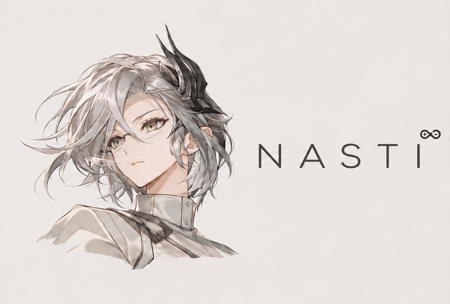
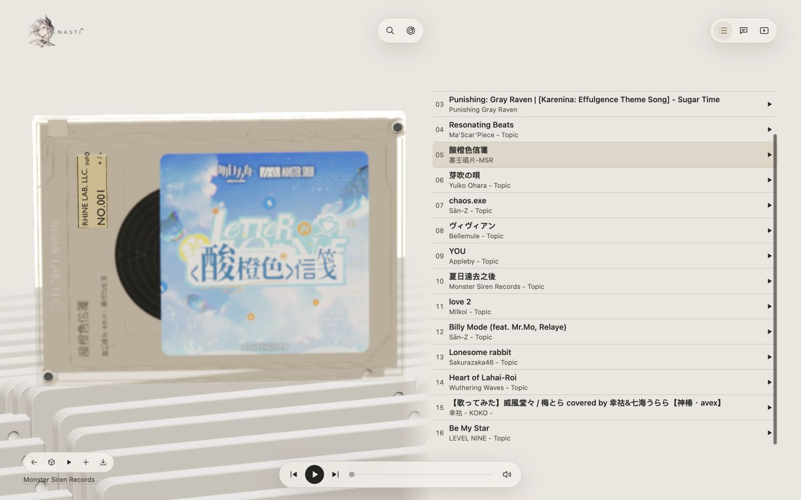

  <picture>
    <source media="(prefers-color-scheme: dark)" srcset="docs/media/brand/nasti-character-logo-dark.png">
    
  </picture>

<h1 align="center">Nasti</h1>

  <strong>Rhine Lab Acoustic Terminal</strong> 
  <strong lang="zh-CN">莱茵生命声学工程终端</strong>

  A desktop music player inspired by Nasti from <em>Arknights</em>. 
  以《明日方舟》娜斯提为灵感的桌面音乐播放器。

  <a href="https://github.com/users/xiaotwu/projects/5/views/2">Roadmap / 开发进度</a>
  ·
  <a href="https://github.com/xiaotwu/Nasti/issues">Issues / 问题反馈</a>

<h2>Preview / 界面预览</h2>

  <em>Desktop preview · macOS in development</em> 
  桌面版预览 · macOS 开发中

  <picture>
    <source media="(prefers-color-scheme: dark)" srcset="docs/media/readme/archive-dark.jpg">
    
  </picture>

  Each column is a playlist. Pull out an archive to play its track. 
  每一列档案对应一个歌单。抽出一份档案，就能播放那首歌。

  The home preview uses the imported playlist’s track metadata with <em lang="zh-CN">酸橙色信箋</em> selected. 
  首页预览采用实际导入的歌单曲目信息，选中《酸橙色信笺》。 
  <a href="https://monster-siren.hypergryph.com/music/880385">Monster Siren Records · Cover art / 塞壬唱片 · 封面来源</a>

  <picture>
    <source media="(prefers-color-scheme: dark)" srcset="docs/media/readme/playback-and-playlist-dark.jpg">
    
  </picture>

  The playback detail shows the official cover and highlights <em lang="zh-CN">酸橙色信箋</em>, the fifth track in the original playlist. 
  播放详情展示官方封面，并在原歌单曲序中高亮第 5 首《酸橙色信笺》。

  Save licensed tracks to Vault and keep listening offline. 
  把授权曲目收进 Vault，离线时也能继续听。

<h2>Assets &amp; Acknowledgements / 素材与致谢</h2>

  <strong>Character and artwork / 角色与标识</strong> 
  Nasti is an independent <em>Arknights</em> fan project. The cover portrait draws on Nasti’s Elite 2 artwork, and the double-ring mark references the Rhine Lab emblem. The original character and emblem belong to Hypergryph and their respective rights holders. 
  Nasti 是《明日方舟》独立同人项目。封面肖像参考娜斯提精二立绘，字标上的双环参考莱茵生命标志。原角色与标志的权利归鹰角网络及相关权利人。 
  <a href="https://ak.hypergryph.com/cvintro">Arknights · Rhine Lab / 明日方舟 · 莱茵生命</a>

  <strong>Archive model and interface / 档案模型与界面</strong> 
  The archive model and motion draw on LBEILC’s RhineLabUI. The music interface also takes inspiration from RonaldDeng’s Rhine-Music-Demo. Both upstream projects use the MIT license. 
  档案模型与动效源自 LBEILC 的 RhineLabUI，音乐界面也参考了 RonaldDeng 的 Rhine-Music-Demo。两个上游项目均采用 MIT 许可。 
  <a href="https://github.com/LBEILC/RhineLabUI/blob/12cc5e4013acb9408f753ff71de6b8492299b7c8/LICENSE">RhineLabUI · MIT</a>
  ·
  <a href="https://github.com/RonaldDeng/Rhine-Music-Demo/blob/main/LICENSE">Rhine-Music-Demo · MIT</a>

  <strong>Featured track and cover art / 展示曲目与封面</strong> 
  The screenshots feature <em lang="zh-CN">酸橙色信笺</em> and its official cover art from Monster Siren Records (MSR). 
  截图展示的曲目为塞壬唱片（MSR）发行的《酸橙色信笺》，封面采用官方发行图。 
  <a href="https://monster-siren.hypergryph.com/music/880385">Official release / 官方发行页</a>
  ·
  <a href="https://music.youtube.com/watch?v=91UkWokuc_o">YouTube Music / 原曲</a>

  <strong>README layout / README 排版</strong> 
  The character-led introduction and interface previews take inspiration from the Clash Nyanpasu README. 
  以角色开场、随后展示界面的排版参考了 Clash Nyanpasu 的 README。 
  <a href="https://github.com/libnyanpasu/clash-nyanpasu#readme">Clash Nyanpasu README</a>

<h2>License / 许可</h2>

  Nasti’s source code is licensed under the GNU General Public License version 3 or later (<code>GPL-3.0-or-later</code>). 
  Nasti 源代码采用 GNU 通用公共许可证第 3 版或任何后续版本（<code>GPL-3.0-or-later</code>）。

  Third-party artwork, marks, models, and recordings retain their respective rights and licenses. 
  第三方美术、标志、模型和录音沿用各自的权利与许可。 
  <a href="https://spdx.org/licenses/GPL-3.0-or-later.html">Read the full license / 查看许可全文</a>

