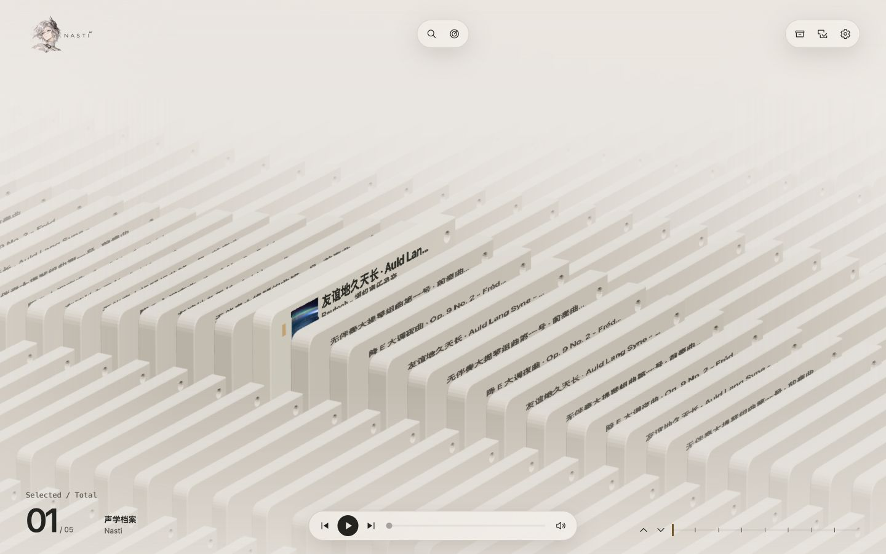

  <picture>
    <source media="(prefers-color-scheme: dark)" srcset="docs/media/brand/nasti-character-logo-dark.png">
    
  </picture>

<h1 align="center">Nasti · 娜斯提</h1>

  <strong>Rhine Lab Acoustic Terminal</strong> 
  <strong lang="zh-CN">莱茵生命声学工程终端</strong>

  A Music Player Inspired by Nasti from <em>Arknights</em>. 
  以《明日方舟》娜斯提为灵感的音乐播放器

  <a href="https://github.com/users/xiaotwu/projects/5/views/2">Roadmap / 开发进度</a>
  ·
  <a href="https://github.com/xiaotwu/Nasti/issues">Issues / 问题反馈</a>

<h2>Preview / 界面预览</h2>

  <em>Desktop preview · macOS in development</em> 
  桌面版预览 · macOS 开发中

  <picture>
    <source media="(prefers-color-scheme: dark)" srcset="docs/media/readme/archive-dark.jpg">
    
  </picture>

  Each column is a playlist. Pull out an archive to play its track. 
  每一列档案对应一个歌单。抽出一份档案，就能播放那首歌。

  The home preview shows the <em lang="zh-CN">直到大地變成一顆酸橙 (Original Soundtrack)</em> in its original order, with the title track selected. 
  首页按《直到大地变成一颗酸橙》原声专辑的曲序展示歌单，选中同名曲。 
  <a href="https://music.youtube.com/playlist?list=OLAK5uy_muPAf3cDjEGtAf8Dxo370mJzvnzbocDjk">Soundtrack playlist / 原声歌单</a>
  ·
  <a href="https://music.youtube.com/watch?v=NscanMhMPgE">Title track / 同名曲</a>

  <picture>
    <source media="(prefers-color-scheme: dark)" srcset="docs/media/readme/playback-and-playlist-dark.jpg">
    
  </picture>

  The playback detail shows the official soundtrack cover and highlights the title track, second in the original playlist. 
  播放详情展示原声专辑官方封面，并高亮原歌单第 2 首同名曲《直到大地变成一颗酸橙》。

  Save licensed tracks to Vault and keep listening offline. 
  把授权曲目收进 Vault，离线时也能继续听。

<h2>Assets &amp; Acknowledgements / 素材与致谢</h2>

  <strong>Character and artwork / 角色与标识</strong> 
  Nasti is an independent <em>Arknights</em> fan project. The cover portrait draws on Nasti’s Elite 2 artwork, and the double-ring mark references the Rhine Lab emblem. The original character and emblem belong to Hypergryph and their respective rights holders. 
  Nasti 是《明日方舟》独立同人项目。封面肖像参考娜斯提精二立绘，字标上的双环参考莱茵生命标志。原角色与标志的权利归鹰角网络及相关权利人。 
  <a href="https://ak.hypergryph.com/cvintro">Arknights · Rhine Lab / 明日方舟 · 莱茵生命</a>

  <strong>Archive model and interface / 档案模型与界面</strong> 
  The archive model and motion draw on LBEILC’s RhineLabUI. The music interface also takes inspiration from RonaldDeng’s Rhine-Music-Demo. Both upstream projects use the MIT license. 
  档案模型与动效源自 LBEILC 的 RhineLabUI，音乐界面也参考了 RonaldDeng 的 Rhine-Music-Demo。两个上游项目均采用 MIT 许可。 
  <a href="https://github.com/LBEILC/RhineLabUI/blob/12cc5e4013acb9408f753ff71de6b8492299b7c8/LICENSE">RhineLabUI · MIT</a>
  ·
  <a href="https://github.com/RonaldDeng/Rhine-Music-Demo/blob/main/LICENSE">Rhine-Music-Demo · MIT</a>

  <strong>Featured track and cover art / 展示曲目与封面</strong> 
  The screenshots feature the title track of <em lang="zh-CN">直到大地變成一顆酸橙 (Original Soundtrack)</em> and its official album cover from Monster Siren Records (MSR). 
  截图展示塞壬唱片（MSR）发行的《直到大地变成一颗酸橙》原声专辑同名曲，封面采用该专辑官方发行图。 
  <a href="https://monster-siren.hypergryph.com/music/697674">Official release / 官方发行页</a>

<h2>License / 许可</h2>

  Nasti’s source code is licensed under the GNU General Public License version 3 or later (<code>GPL-3.0-or-later</code>). 
  Nasti 源代码采用 GNU 通用公共许可证第 3 版或任何后续版本（<code>GPL-3.0-or-later</code>）。

  Third-party artwork, marks, models, and recordings retain their respective rights and licenses. 
  第三方美术、标志、模型和录音沿用各自的权利与许可。 
  <a href="https://spdx.org/licenses/GPL-3.0-or-later.html">Read the full license / 查看许可全文</a>

## Get Nasti / 下载与构建

Download the Apple Silicon macOS prerelease from [GitHub Releases](https://github.com/xiaotwu/Nasti/releases). This is an empty-library build. Use Nasti's search to access the supported licensed Internet Archive catalog. YouTube Music playlist management requires your own OAuth configuration and opens playback externally.

从 [GitHub Releases](https://github.com/xiaotwu/Nasti/releases) 下载 Apple Silicon macOS 预发行版。首次打开时曲库为空。可从 Nasti 检索支持的 Internet Archive 授权目录。YouTube Music 歌单管理需要自行配置 OAuth，播放由 YouTube Music 打开。

从空曲库开始时，首页可直接打开授权曲库、导入歌单或进入 YouTube Music。使用 YouTube Music 前，在 Google Cloud 启用 [YouTube Data API v3](https://developers.google.com/youtube/data/guides/authentication) 并下载[桌面应用 OAuth 客户端 JSON](https://developers.google.com/identity/protocols/oauth2/native-app)，然后在 Nasti 导入面板选择文件并连接 Google。该文件只保存在本机。

From the empty home screen, open the licensed catalog, import a playlist, or open YouTube Music. To use YouTube Music, enable the YouTube Data API v3, download a Desktop app OAuth client JSON from Google Cloud, select it in Nasti, and connect your account. The configuration stays on your Mac.

Build with Node, pnpm 11, Rust and Xcode. Run `pnpm install --frozen-lockfile` and then `pnpm --dir hosts/load-bearing-crew exec tauri build --bundles app`. See the [release fidelity specification](docs/RELEASE_FIDELITY_SPEC.md) and [third-party notices](NOTICE.md).
